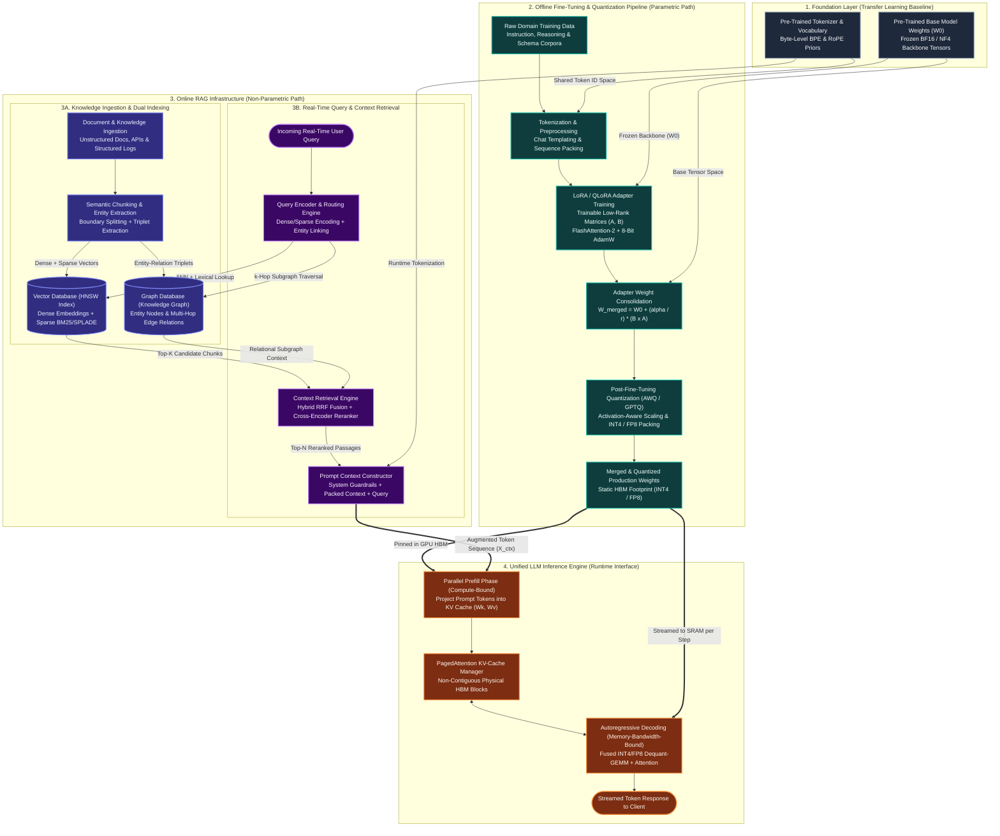

# Technical Research Manual: Project Overview & System Architecture Design

**Core Domains:** LLM Fine-Tuning (PEFT/LoRA), Quantization (PTQ/QAT), Memory Optimization, and Retrieval Architectures (RAG)

**Author:** Aamna Ansari
**Date:** In-Progress
**Version:** 1.0

---

## 1. Project Overview & Objectives

### 1.1 Project Overview

Calling `model.generate()` in a notebook or wrapping an external API is straightforward; engineering a model to serve thousands of concurrent requests under strict latency, throughput, and GPU memory ceilings is a fundamentally different discipline. This Technical Research Manual serves as our team's core engineering reference and architectural field guide for building, optimizing, and deploying production-grade Large Language Model (LLM) systems.

Rather than treating model development as isolated experiments, this manual unifies four interdependent domains that govern real-world LLM performance:

* **LLM Fine-Tuning:** Full-parameter updates, Parameter-Efficient Fine-Tuning (LoRA, QLoRA, DoRA), and post-training alignment (DPO, RLHF), with a focus on hyperparameter sensitivity, catastrophic forgetting, and dataset curation.
* **Quantization:** Post-Training Quantization (PTQ) and Quantization-Aware Training (QAT) across INT8, INT4, and FP8 data types (including AWQ, GPTQ, and KV-cache quantization), analyzing the trade-off between memory footprint reduction and dequantization overhead.
* **Memory Optimization:** Hardware-aware techniques that maximize GPU utilization and prevent Out-Of-Memory (OOM) failures, including FlashAttention (SRAM tiling), PagedAttention for contiguous KV-cache management, activation checkpointing, and distributed sharding via ZeRO and FSDP.
* **Retrieval Architectures:** Production Retrieval-Augmented Generation (RAG) systems encompassing hybrid lexical-semantic search (BM25/SPLADE paired with dense bi-encoders), approximate nearest neighbor (ANN) indexing (HNSW, IVF-PQ), context-aware chunking, and cross-encoder reranking.

Compiling and maintaining this research is a mandatory engineering requirement before provisioning multi-GPU clusters or shipping model updates. Academic papers rarely document how these four layers interact under production failure modes—such as how aggressive weight quantization affects downstream LoRA adapter convergence, or how long-context RAG payloads shift inference bottlenecks from model weights to KV-cache memory bandwidth. Documenting our empirical benchmarks, mathematical foundations, and architectural failure modes establishes a rigorous baseline so every engineer builds on verified systems knowledge rather than trial-and-error guesswork.

**This manual is organized into multiple sections. Section 2 (System Architecture Design) presents the unified parametric + non-parametric pipeline that integrates offline fine-tuning, post-fine-tuning quantization, and online retrieval into a single production architecture. Subsequent sections address quantization-aware training (QAT), KV-cache quantization, distributed sharding (ZeRO/FSDP), and advanced retrieval indexing (IVF-PQ) in depth.**

### 1.2 Core Objectives

* **Bridge theoretical research and production engineering:** Translate mathematical formulations from recent literature into reproducible, fault-tolerant codebases that meet strict throughput, latency, and reliability targets.
* **Master hardware-aware memory and compute budgeting:** Calculate exact VRAM footprints across model weights, gradients, AdamW optimizer states, intermediate activations, and dynamic KV caches before launching a single training job or inference worker.
* **Evaluate quantization and compression trade-offs empirically:** Benchmark low-bit quantization schemes (AWQ, GPTQ, FP8) across both memory-bound token generation and compute-bound prefill phases to measure perplexity drift, calibration sensitivity, and real-world latency gains.
* **Establish clear decision boundaries between RAG and fine-tuning:** Determine systematically when to inject volatile, factual knowledge at inference time via retrieval pipelines versus when to adapt model weights for domain-specific syntax, reasoning structures, or strict output formatting.
* **Architect low-latency retrieval and ranking pipelines:** Design end-to-end retrieval systems that balance vector index recall, memory overhead, hybrid scoring, and cross-encoder reranking within millisecond-level latency budgets.
* **Standardize benchmarking and ablation methodology:** Replace anecdotal "vibe checks" with automated evaluation harnesses that track tokens-per-second throughput, Time-To-First-Token (TTFT), peak VRAM allocation, and task-specific accuracy across every architectural change.

### 1.3 Target Audience & Learning Outcomes

Most intermediate and advanced interns enter the industry with a solid grasp of deep learning fundamentals: you already understand transformer self-attention, backpropagation, and how to train or fine-tune a model on a clean academic dataset. However, academic coursework and personal projects almost always abstract away the physical hardware. In a university lab or a weekend prototype, an inefficient attention implementation or an unoptimized data loader simply means waiting an extra twenty minutes for a script to finish. In production, those same inefficiencies translate directly into exhausted HBM capacity, stalled multi-node training runs, violated latency SLAs, and tens of thousands of dollars in wasted compute.

Closing the gap between an academic developer and a production-grade AI engineer requires shifting how you look at a model. You must stop viewing an LLM solely as a mathematical graph of layers and start viewing it as a systems workload bound by GPU memory hierarchy (SRAM vs. HBM bandwidth), arithmetic intensity (FLOPs-to-byte ratios), and network interconnects.

Working through this manual will train you to ask and answer the questions that define senior engineering work:

* Why does autoregressive token generation become memory-bandwidth bound at small batch sizes, and how does weight-only quantization alleviate that specific bottleneck?
* When does the dequantization overhead of 4-bit weights actually slow down inference during large-batch prefill?
* Why does scaling context length from 4K to 128K shift the primary memory bottleneck from static model weights to dynamic KV-cache allocation, and how do PagedAttention and GQA (Grouped-Query Attention) solve it?
* Why does naive cosine similarity over fixed-size text chunks fail on complex multi-hop queries, and how do you redesign the indexing and reranking architecture without blowing past your latency budget?

Internalizing these memory, compute, and architectural design patterns is what separates practitioners who merely assemble high-level library calls from engineers who can architect, profile, debug, and scale modern AI systems from the ground up.

## 2. System Architecture Design

Production LLM engineering requires unifying two complementary adaptation mechanisms that are too often designed in silos: **parametric adaptation** (modifying model weights offline via fine-tuning and quantization) and **non-parametric conditioning** (injecting retrieved external context online into the model's forward pass via RAG). Treating these two pipelines as a single architecture ensures that domain-specific reasoning patterns are baked directly into compact model weights, while volatile facts and relational knowledge are supplied dynamically at runtime.

### 2.0 Unified Architecture Diagram (Mermaid.js)

### 2.1 The Foundational Weight Space (Transfer Learning Base)

Every production LLM system begins with a pre-trained foundation checkpoint ($W_0 \in \mathbb{R}^{d \times k}$). Training a frontier-class transformer from scratch requires trillions of tokens and **hundreds to low-thousands of GPU-days** (depending on model scale and accelerator generation) to establish basic syntactic structure, world knowledge, and multi-head attention routing. In our architecture, the foundation layer acts as an immutable **transfer learning baseline** that supplies critical architectural assets to downstream pipelines:

* **Pre-trained feature representations ($W_0$):** The lower and middle transformer blocks already encode universal linguistic primitives, code syntax, and compositional reasoning circuits. Modifying all $d \times k$ parameters directly on small domain datasets risks **catastrophic forgetting**—overwriting general reasoning circuits to memorize narrow training examples—while requiring roughly $16\text{ to }20\text{ bytes per parameter}$ in GPU memory for full mixed-precision training (weights, gradients, FP32 master weights, and AdamW first/second moments).
* **Unified Vocabulary & Tokenization Protocol:** The pre-trained tokenization framework (whether using Byte-Pair Encoding (BPE), WordPiece, or Unigram variants) defines the canonical token ID space shared between offline fine-tuning and online RAG prompt construction. Preserving the exact vocabulary and structural embedding table ensures tokenization compatibility across the entire lifecycle, minimizing token-misalignment errors during runtime context injection. However, engineers must note that maintaining a static vocabulary only ensures structural compatibility; it does not eliminate semantic distribution shifts when the model encounters custom domain vocabularies or out-of-distribution RAG contexts.
* **Architecture-Specific Positional Priors:** The foundation model establishes the sequence-length capability via its hardcoded positional encoding layer—such as Rotary Position Embeddings (RoPE), ALiBi, or absolute learned encodings. Keeping these positional priors constant during initial parameter-efficient training preserves the model's intrinsic multi-head attention routing and relative sequence processing capabilities before any context-window expansion techniques are implemented.

### 2.2 Parameter-Efficient Adaptation Layer (LoRA/QLoRA Path)

To teach the model domain-specific behavior—such as strict JSON/schema adherence, specialized medical or financial syntax, or multi-step analytical reasoning—without mutating the base checkpoint, the **Offline Fine-Tuning Pipeline** routes domain training data through a Parameter-Efficient Fine-Tuning (PEFT) loop.

* **Sequence packing and chat templating:** Raw domain records are formatted into deterministic chat templates and packed into contiguous context blocks (e.g., 4,096 or 8,192 tokens) separated by attention-mask boundary resets (`cu_seqlens` in FlashAttention-2). Sequence packing eliminates padding waste, raising hardware FLOPs utilization (MFU) from under 25% to over 55%.
* **Low-rank weight decomposition:** Instead of computing full weight updates $\Delta W \in \mathbb{R}^{d \times k}$, LoRA constrains the update to a low-rank decomposition across all linear attention ($W_q, W_k, W_v, W_o$) and SwiGLU MLP ($W_{\text{gate}}, W_{\text{up}}, W_{\text{down}}$) projections:
  $$h = W_0 x + \Delta W x = W_0 x + \frac{\alpha}{r} B A x$$
  where $A \in \mathbb{R}^{r \times k}$, $B \in \mathbb{R}^{d \times r}$, and the rank $r \ll \min(d, k)$ (typically $r \in \{16, 32, 64\}$). When memory is constrained, QLoRA quantizes the frozen backbone $W_0$ into 4-bit NormalFloat (`NF4`) with double quantization, dequantizing tiles of $W_0$ into `BF16` inside on-chip SRAM only for the duration of each forward and backward matrix multiplication.
* **Offline consolidation and Post-Fine-Tuning Quantization (PTQ):** Serving unmerged LoRA adapters in production introduces an extra kernel launch ($B \times (A \times x)$) unless multi-tenant LoRA routing (e.g., Punica/S-LoRA) is required. For dedicated single-domain deployments, our pipeline merges the converged adapter back into the base weights offline ($W_{\text{merged}} = W_0 + \frac{\alpha}{r}BA$ in `BF16`) and immediately passes the consolidated checkpoint through **Activation-Aware Weight Quantization (AWQ)** or **GPTQ**. This quantization step is applied to the consolidated fine-tuned weights, distinct from any pre-training quantization of the base checkpoint. Using a small calibration set of 128–512 domain sequences, the PTQ engine identifies the top ~1% of salient weight channels corresponding to high-magnitude activations, scales them to prevent clipping, and packs the weights into `INT4` (or `FP8` on Hopper/Blackwell GPUs).

### 2.3 Contextual Retrieval Infrastructure (Vector & Graph RAG Path)

Fine-tuning adapts *how* a model reasons and formats responses, but it is the wrong mechanism for storing rapidly changing facts, proprietary records, or verifiable citations. The **Online RAG Infrastructure** decouples volatile factual storage from model weights by combining a **Vector Database Engine** with a **Graph Database Engine** to build a comprehensive hybrid retrieval network.

* **Dual-store Ingestion Pipeline (Vector + Graph):** Incoming documents are split along semantic and structural boundaries rather than arbitrary character counts. Each chunk passes through parallel indexing paths across distinct search subsystems:
  1. **Dense Vector Index (HNSW):** Dense bi-encoder embeddings are indexed into a Hierarchical Navigable Small World (HNSW) graph. Under typical conditions and optimal hyperparameter configurations, HNSW provides an expected $O(\log N)$ approximate nearest neighbor (ANN) search complexity, capturing deep semantic similarity across continuous vector spaces.
  2. **Sparse Lexical Index:** In parallel to the dense vector graph, exact keyword matches and lexical signals are captured using distinct retrieval mechanisms—such as traditional inverted indexes for BM25 or high-dimensional sparse vector indexes optimized for learned sparse representations like SPLADE.
  3. **Graph Database (Knowledge Graph):** An entity-relation extraction pipeline identifies domain entities (nodes) and explicit structural dependencies (directed edges) across documents, storing them in a graph database. While dense vector similarity struggles when answering multi-hop questions that span disconnected documents (e.g., *"How does a failure in Component A impact downstream Service C via Dependency B?"*), a $k$-hop graph traversal retrieves the exact relational path deterministically.
* **Context Retrieval Engine (Hybrid Fusion & Reranking):** When a user query arrives, the **Query Encoder & Routing Engine** generates dense and sparse query representations while simultaneously extracting anchor entities. Candidate passages are fetched from their respective subsystems—the HNSW dense index and the sparse lexical index—alongside relational subgraphs from the Graph DB. These multi-source candidate pools are normalized and merged using **Reciprocal Rank Fusion (RRF)**:
  $$\text{RRF\_Score}(d \in D) = \sum_{m \in \{\text{dense}, \text{sparse}, \text{graph}\}} \frac{1}{k_{\text{rrf}} + \text{rank}_m(d)}$$
  Because bi-encoders compress queries and documents into independent vectors, subtle semantic negations or qualifiers can slip through initial retrieval phases. The top-$K$ fused candidates (e.g., $K = 50$) are therefore scored jointly with the raw query text through a computationally intensive **Cross-Encoder Reranker**, which computes full token-to-token cross-attention across the $(q, d_i)$ pairs and selects the top-$N$ highest-precision passages (e.g., $N = 5$).
* **Prompt Context Constructor:** The verified passages and serialized graph relationships are injected into a structured prompt template alongside strict citation instructions and token budget guards, producing the final tokenized sequence $X_{\text{ctx}}$ for the downstream inference engine.

### 2.4 The Runtime Interface (How Context and Weights Merge during Inference)

A common misconception among junior engineers is that RAG "updates" model weights at runtime. In reality, **parametric weights ($W_{\text{quant}}$) and non-parametric context ($X_{\text{ctx}}$) never mix in weight space—they fuse inside the attention mechanism via the Key-Value (KV) Cache.**

Inside the **Unified LLM Inference Engine** (powered by vLLM or TensorRT-LLM), the merge between the offline and online paths occurs across two distinct hardware execution regimes:

1. **The Compute-Bound Prefill Phase (Context-to-KV Projection):**
   The tokenized prompt $X_{\text{ctx}} = [\text{System}, \text{Retrieved Context}, \text{User Query}]$ of length $S_{\text{prompt}}$ enters the GPU as a single parallel sequence. At each transformer layer $l$, the engine multiplies the input activations against the static, fine-tuned, quantized projection weights ($W_q^{(l)}, W_k^{(l)}, W_v^{(l)}$):
   $$Q^{(l)} = X^{(l)} W_q^{(l)}, \quad K_{\text{ctx}}^{(l)} = X^{(l)} W_k^{(l)}, \quad V_{\text{ctx}}^{(l)} = X^{(l)} W_v^{(l)}$$
   Here, the fine-tuned weights transform the raw retrieved RAG tokens into specialized key and value representations ($K_{\text{ctx}}^{(l)}, V_{\text{ctx}}^{(l)}$) that are written into physical HBM blocks managed by **PagedAttention**. Because all $S_{\text{prompt}}$ tokens are processed simultaneously via large matrix-matrix multiplications (GEMMs), the prefill phase is **compute-bound** (high FLOPs-to-byte ratio) and determines the system's **Time-To-First-Token (TTFT)**.
2. **The Memory-Bandwidth-Bound Decoding Phase (Joint Parametric + Contextual Attention):**
   Once prefill completes, the engine generates output tokens $y_1, y_2, \dots, y_T$ one step at a time. At step $t$, only the newly generated token embedding $x_t \in \mathbb{R}^{1 \times d}$ passes through the linear layers (a matrix-vector multiplication, or GEMV). The resulting query vector $q_t^{(l)}$ computes scaled dot-product attention over the entire concatenated KV cache—which holds both the **prefilled RAG context keys/values** and the **previously generated output keys/values**:
   $$\text{Attention}\left(q_t^{(l)}, \left[K_{\text{ctx}}^{(l)} \,\Vert\, K_{1:t}^{(l)}\right], \left[V_{\text{ctx}}^{(l)} \,\Vert\, V_{1:t}^{(l)}\right]\right) = \text{softmax}\left(\frac{q_t^{(l)} \left[K_{\text{ctx}}^{(l)} \,\Vert\, K_{1:t}^{(l)}\right]^\top}{\sqrt{d_k}}\right) \left[V_{\text{ctx}}^{(l)} \,\Vert\, V_{1:t}^{(l)}\right]$$
   This equation is the exact runtime interface of the architecture: the **fine-tuned weights** ($W_q, W_o, W_{\text{MLP}}$) govern how the model queries, transforms, and formats information, while the **KV cache** ($K_{\text{ctx}}, V_{\text{ctx}}$) supplies the grounded factual evidence retrieved from the Vector and Graph databases.

**Note on Grouped-Query Attention (GQA):** Modern production transformers (e.g., Llama 3.1, Mistral) default to GQA, where multiple query heads share a single key/value head projection. This architectural choice dramatically reduces the KV cache memory footprint—in the 8B reference model used throughout this document, 32 query heads share only 8 KV heads—cutting the per-token KV cache size by 4x compared to standard Multi-Head Attention (MHA).

### 2.5 Data and Weight Flow Mechanics: Offline Training vs. Online Inference

Understanding how data and weights move across storage, host RAM, GPU HBM, and on-chip SRAM across the two operational cycles is essential for capacity planning and bottleneck debugging.

* **Offline Training & Compression Cycle (Throughput-Oriented, High Mutability):**
  * **Data Trajectory:** Large Arrow/Parquet shards stream sequentially from NVMe disk into pinned host RAM, transfer asynchronously over PCIe to GPU HBM as packed token batches ($B \times S$), and generate dense intermediate activations at every layer during the forward pass.
  * **Weight & Gradient Trajectory:** Base weights ($W_0$) remain frozen in HBM (`BF16` or `NF4`), while adapter matrices ($A, B$) undergo continuous read-modify-write cycles. During backpropagation, activation checkpoints are recomputed on the fly to calculate parameter gradients ($\nabla_A, \nabla_B$), which update FP32 master weights and 8-bit `AdamW` momentum/variance buffers.
  * **Primary Hardware Bottleneck:** Compute (Tensor Core FLOPs) and activation HBM capacity. Because batch sizes and sequence lengths are large ($B \times S \gg 1,024$), every weight fetched from HBM into SRAM is reused across thousands of tokens, yielding high arithmetic intensity.
* **Online Real-Time RAG Inference Cycle (Latency-Oriented, Zero Weight Mutability):**
  * **Data Trajectory:** A single user query triggers network I/O to the Vector DB (HNSW in-memory graph traversal) and Graph DB, returning kilobytes of text chunks that expand the prompt into thousands of input tokens ($S_{\text{prompt}}$). During prefill and decoding, those tokens allocate dynamic **KV-cache blocks** in GPU HBM that grow linearly with sequence length and concurrency ($2 \times n_{\text{layers}} \times n_{\text{kv\_heads}} \times d_{\text{head}} \times S_{\text{total}}$).
  * **Weight Trajectory:** Production weights ($W_{\text{quant}}$) are completely read-only and pinned in HBM. However, during autoregressive decoding, the GPU must stream the *entire* 4-bit or 8-bit weight matrix from HBM into on-chip registers/SRAM just to generate **one token per active sequence**, alongside reading the entire RAG KV cache from HBM.
  * **Primary Hardware Bottleneck:** **HBM Memory Bandwidth** during decoding (governing Inter-Token Latency, or ITL) and **Tensor Core Compute** during long-context RAG prefill (governing Time-To-First-Token, or TTFT). Compressing weights to `INT4` directly accelerates decoding by cutting the bytes transferred over the HBM bus by ~4x compared to `BF16`.

| System Dimension | Offline Adaptation Cycle (LoRA / QLoRA + PTQ) | Online Real-Time Inference Cycle (Vector/Graph RAG + Serving) |
| :--- | :--- | :--- |
| **Primary Objective** | Maximize convergence stability and tokens-per-second training throughput | Minimize Time-To-First-Token (TTFT) and Inter-Token Latency (ITL) under SLA |
| **Weight State & Precision** | Frozen `BF16`/`NF4` base weights ($W_0$) + mutable `BF16`/`FP32` adapter weights ($A, B$) | Immutable, merged, quantized weights (`INT4` AWQ/GPTQ or `FP8`, **~4.5–8.5 GB** for 8B) |
| **Dominant VRAM Consumer** | Intermediate forward activations, backward gradients, and `AdamW` optimizer states | Dynamic **KV Cache** (scales with RAG context length $\times$ concurrent user batch size) |
| **Compute vs. Memory Regime** | **Compute-bound** (large GEMMs across packed batches; high FLOPs-to-byte ratio) | **Compute-bound** during RAG prefill (GEMM); **Memory-bandwidth-bound** during decoding (GEMV) |
| **External I/O Dependencies** | High-throughput sequential reads from local NVMe / distributed object storage | Low-latency parallel RPCs to Vector DB (HNSW RAM index), Graph DB, and Reranker |
| **Memory Management Strategy** | Activation checkpointing, FlashAttention-2 SRAM tiling, ZeRO / FSDP sharding | **PagedAttention** non-contiguous KV blocks, prefix caching for shared system/RAG prompts |

## 3. Core Operational Flow & State Diagrams

Architecting a production LLM system requires treating training, compression, and retrieval-augmented inference as a single continuous state machine rather than disconnected scripts. Every transition between stages alters the memory layout on the GPU, changes the arithmetic intensity of the workload, and introduces specific failure modes—from precision loss during adapter merging to KV-cache fragmentation during long-context retrieval.

### 3.1 Core Operational Flow (Step-by-Step Pipeline Blueprint)

At the top level, the system initializes from a single pre-trained foundation checkpoint and bifurcates into two coordinated tracks: an **Offline Adaptation & Compression Track** (Phases 1–3) that updates and compacts the model weights, and an **Online Retrieval & Inference Track** (Phase 4) that injects live external knowledge at runtime.

**[System Init: Raw Checkpoint & Corpus]** -> **[Phase 1: Data Routing & Tokenization]** -> **[Phase 2: PEFT/LoRA Adaptation]** -> **[Phase 3: Quantization & Weight Packing]** -> **[Phase 4: RAG Runtime & Paged Inference]**

#### Phase 1: System Initialization & Data Routing

**[1.1: Checkpoint Validation]** -> **[1.2: Corpus Bifurcation]** -> **[1.3: Tokenizer & Sequence Packing]** -> **[1.4: Vector & Graph Index Ingestion]**

* **Validate base model artifacts:** Load the pre-trained model configuration, verify vocabulary size and RoPE (Rotary Position Embedding) scaling factors, and pin `safetensors` weight shards in host RAM using memory-mapped I/O (`mmap`) to prevent host memory exhaustion.
* **Bifurcate domain data by volatility:** Route static behavioral patterns, output schemas, and domain syntax to the Supervised Fine-Tuning (SFT) dataset; route volatile, high-churn factual records and reference documents to the external RAG ingestion pipeline.
* **Format and tokenize training sequences:** Apply strict chat/instruction templates, run byte-level BPE tokenization, and pack variable-length examples into fixed-length context blocks using attention-mask boundary resets so GPU tensor cores never waste compute on padding tokens.
* **Build the hybrid vector and graph indexes:** Chunk reference documents along semantic and structural boundaries, generate dense vector embeddings alongside sparse lexical weights (BM25/SPLADE) for the HNSW index, and extract entity-relationship triplets for the Knowledge Graph.

#### Phase 2: Supervised Fine-Tuning (SFT) & LoRA Injection Pipeline

**[2.1: Base Weight Freezing]** -> **[2.2: LoRA Matrix Injection]** -> **[2.3: Mixed-Precision Forward/Backward Pass]** -> **[2.4: Adapter Weight Merging]**

* **Freeze backbone parameters:** Load the pre-trained weights $W_0 \in \mathbb{R}^{d \times k}$ into GPU High-Bandwidth Memory (HBM) in `BF16` (for standard LoRA) or 4-bit NormalFloat `NF4` (for QLoRA) and disable gradient tracking (`requires_grad = False`) across all base layers.
* **Inject low-rank adapter matrices:** Attach trainable low-rank matrices $A \in \mathbb{R}^{r \times k}$ (initialized via Kaiming uniform distribution) and $B \in \mathbb{R}^{d \times r}$ (initialized to zero, where $r \ll \min(d, k)$) parallel to target linear projections ($W_q, W_k, W_v, W_o, W_{\text{gate}}, W_{\text{up}}, W_{\text{down}}$).
* **Execute memory-optimized training steps:** Run forward and backward passes using FlashAttention-2 (keeping intermediate attention matrices tiled in fast on-chip SRAM rather than writing $O(N^2)$ tensors to HBM) and activation checkpointing, updating only the adapter parameters via 8-bit or fused `AdamW` optimizers.
* **Merge adapters into the base checkpoint:** Once validation perplexity and task metrics converge, dequantize base weights to `BF16` (if QLoRA was used), compute the consolidated weight matrix $W_{\text{merged}} = W_0 + \frac{\alpha}{r}(B \times A)$, and serialize the standalone `BF16` checkpoint to disk to eliminate adapter routing latency during inference.

#### Phase 3: Post-Fine-Tuning Quantization (PTQ) & Engine Compilation

**[3.1: Calibration Set Profiling]** -> **[3.2: Salient Channel Scaling]** -> **[3.3: Low-Bit Weight Packing]** -> **[3.4: Serving Engine Export]**

* **Profile activation distributions:** Pass a representative calibration subset (typically 128–512 domain-matched sequences) through the merged `BF16` model to record per-channel activation magnitudes and identify outlier features.
* **Compute quantization scales and zero-points:** Apply Activation-Aware Weight Quantization (AWQ) to scale salient weight channels (~1% of channels corresponding to high-magnitude activations) or GPTQ (second-order Hessian-based error compensation) to minimize layer-wise reconstruction loss.
* **Pack weights into compact integer kernels:** Quantize linear layer weights into `INT4` or `INT8` (or `FP8` on Hopper/Blackwell architectures), grouping parameters into blocks (e.g., group size 128) with dedicated `FP16` scale factors while keeping normalization layers (`RMSNorm`) and the language modeling head (`lm_head`) in full `BF16` precision.
* **Compile the execution graph:** Export the packed checkpoint into the target inference runtime (vLLM or TensorRT-LLM), binding custom CUDA/Triton fused dequantization-GEMM kernels optimized for the target GPU compute capability.

#### Phase 4: Active RAG Runtime & Inference Loop

**[4.1: Query Encoding & Dual Retrieval]** -> **[4.2: Cross-Encoder Reranking]** -> **[4.3: Prompt Assembly & Prefill]** -> **[4.4: Paged Autoregressive Decoding]**

* **Retrieve candidate context chunks and subgraphs:** Encode the incoming user query into dense and sparse representations, execute parallel HNSW vector lookups and Knowledge Graph traversals, and fuse the top-$K$ candidate lists (e.g., $K = 50$) using Reciprocal Rank Fusion (RRF).
* **Rerank and filter for precision:** Score the fused candidate pairs $(q, d_i)$ through a lightweight cross-encoder reranker, truncating the output to the top-$N$ highest-relevance passages (e.g., $N = 5$) that fit within the allocated context window budget.
* **Assemble the prompt and execute prefill:** Inject the verified passages into the system prompt template, tokenize the augmented payload, and execute the compute-bound parallel prefill pass to populate the initial Key-Value (KV) cache blocks.
* **Decode tokens via PagedAttention:** Generate output tokens autoregressively, allocating non-contiguous physical KV-cache blocks on demand via a virtual block table to eliminate external memory fragmentation and bound internal fragmentation to at most one block per sequence, even across concurrent user requests.

### 3.2 System State Diagrams (State-Transition Matrix)

The table below defines the formal state transitions across the unified model lifecycle. To make VRAM impacts concrete, memory figures reference a standard **8-billion-parameter (8B) dense transformer** architecture (32 layers, 32 attention heads, 8 KV heads via Grouped-Query Attention, hidden dimension 4096) running on a single enterprise GPU.

| Current State | Trigger / Event | Next State | System Action & VRAM Impact |
| :--- | :--- | :--- | :--- |
| **S0: Uninitialized (Cold Storage)** | `init_model_load()` invoked by training or serving orchestrator | **S1: Base Model (Frozen / Pre-trained)** | Streams `BF16` weight shards from NVMe storage to host RAM via `mmap`, then copies tensors to GPU HBM. Allocates CUDA context (~0.8 GB) and static `BF16` model weights (2 bytes/param = **~16.0 GB VRAM**). Gradient buffers and optimizer states remain unallocated (0 GB). |
| **S1: Base Model (Frozen / Pre-trained)** | `prepare_dataset()` & `inject_DataLoader()` executed | **S2: Dataset Loaded & Tokenized** | Memory-maps Apache Arrow/Parquet token buffers in host RAM and allocates pinned (`page-locked`) host memory for asynchronous CPU-to-GPU DMA transfers (`non_blocking=True`). GPU VRAM increases negligibly (**+0.1 to 0.3 GB** for pre-fetched input ID and attention mask tensors). |
| **S2: Dataset Loaded & Tokenized** | `init_peft_lora()` & `trainer.train()` loop started | **S3: PEFT / LoRA Training Active** | Freezes base weights (`W_0`) and injects trainable `BF16` adapter matrices (`A`, `B`). Allocates trainable parameters (~0.1–0.4 GB), `BF16` adapter gradients (~0.1–0.4 GB), FP32 master weights + `AdamW` first/second moment states (~0.8–2.4 GB), and intermediate forward activations. With FlashAttention-2 and activation checkpointing at batch size 4 (seq len 4096), total footprint reaches **~22.0 to 26.0 GB VRAM** (or **~10.0 to 14.0 GB VRAM** if base weights are loaded in 4-bit `NF4` via QLoRA). |
| **S3: PEFT / LoRA Training Active** | `merge_and_unload()` triggered upon validation convergence | **S4: Fine-Tuned Weights Merged** | Purges optimizer states, gradients, and activation buffers from HBM (`torch.cuda.empty_cache()`). If QLoRA was used, dequantizes 4-bit base weights back to `BF16` first. Computes $W_{\text{merged}} = W_0 + \frac{\alpha}{r}BA$ in-place per layer and unloads adapter modules. GPU memory returns to baseline static weight footprint (**~16.0 GB VRAM**). |
| **S4: Fine-Tuned Weights Merged** | `run_ptq_calibration()` (AWQ / GPTQ) executed | **S5: Model Quantized (INT4 / INT8)** | Runs forward-only calibration batches to compute per-group scale factors, packs weights into low-bit integer tensors, and releases `BF16` master weights. Static weight footprint drops to **~8.5 GB VRAM** (`INT8`, 1 byte/param + scales) or **~4.5 to 5.0 GB VRAM** (`INT4`, 0.5 bytes/param + `FP16` group scales and unquantized `lm_head`). |
| **S5: Model Quantized (INT4 / INT8)** | Incoming user query triggers `rag_retrieve_and_generate()` | **S6: Active Inference with Dynamic Context Injection (RAG)** | Executes query embedding and cross-encoder reranking (+0.5 to 1.5 GB VRAM if co-located on the same GPU), prepends retrieved chunks to the prompt, and allocates PagedAttention KV-cache blocks. Under GQA (`BF16` KV cache), each token consumes ~128 KB ($2 \times 32 \text{ layers} \times 8 \text{ KV heads} \times 128 \text{ dim} \times 2 \text{ bytes}$). A single 8,192-token RAG context adds **~1.05 GB VRAM**; 16 concurrent 8K requests add **~16.8 GB VRAM** on top of the 5.0 GB `INT4` weights (**~22.5 GB total VRAM**). |
| **S6: Active Inference with Dynamic Context Injection (RAG)** | Generation hits `EOS` token or `max_new_tokens` limit | **S5: Model Quantized (INT4 / INT8) [Serving Standby]** | Streams final response chunk to client and decrements reference counts on physical KV-cache blocks in the PagedAttention block manager. Freed KV blocks return immediately to the pre-allocated memory pool without triggering expensive CUDA `cudaFree()` system calls, holding the serving worker ready for the next request. |

### 3.3 Exception & Memory-Pressure Transitions

Production systems must also handle out-of-bounds operational states gracefully without crashing the underlying worker process.

| Current State | Exception / Fault Trigger | Recovery Target State | Automated Mitigation & VRAM Recovery Action |
| :--- | :--- | :--- | :--- |
| **S3: PEFT / LoRA Training Active** | `CUDA OutOfMemoryError` during backward pass activation spike | **S3: PEFT / LoRA Training Active (Sub-Batched)** | Catches OOM exception, clears cached PyTorch blocks, halves micro-batch size (\(B_{\text{micro}} \leftarrow B_{\text{micro}} / 2\)), and doubles gradient accumulation steps (\(G_{\text{acc}} \leftarrow G_{\text{acc}} \times 2\)) to preserve the exact effective batch size while cutting peak activation VRAM by ~50%. |
| **S6: Active Inference (RAG)** | Free KV-cache block pool drops below 5% watermark under high concurrency | **S6: Active Inference (Preempted / Swapped)** | Pauses lowest-priority decoding request and either swaps its physical KV-cache blocks asynchronously to pinned host RAM over PCIe/NVLink or evicts the blocks and recomputes prefill once active requests complete. |
| **S6: Active Inference (RAG)** | Retrieved RAG payload + user query exceeds model `max_position_embeddings` | **S6: Active Inference (Truncated Context)** | Intercepts prompt assembly prior to prefill, drops lowest-scoring reranked chunks from the tail of the retrieval list until token count fits within `max_seq_len - max_new_tokens`, and logs a context-truncation warning to telemetry.

## 4. Core Operational Flow & State Diagrams

### 4.1 Model Lifecycle Flowchart

### 4.2 Stage-by-Stage Breakdown

| Stage | What Happens | Model State |
| :--- | :--- | :--- |
| **Base Model Checkpoint** | Load a pre-trained model in `BF16`. Weights are frozen. | Read-only, ~16 GB VRAM (8B). |
| **Dataset Prep & Tokenization** | Clean, template, and pack domain data into token batches. | Weights unchanged; data flows to GPU. |
| **PEFT / LoRA Training Active** | Inject small trainable adapters (A, B). Only these update. | Adapters mutable; base frozen. |
| **Fine-Tuned Adapter Weights** | Merge adapters into base: `W_merged = W0 + (α/r)BA`. | Single merged model, no adapter overhead. |
| **Model Quantization (INT4/INT8)** | Calibrate and pack weights with AWQ or GPTQ. | Static weights shrink to ~4.5–8.5 GB. |
| **Production Inference with RAG** | Retrieve context, rerank, prepend to prompt, generate. | Weights frozen; KV cache grows per request. |

**Key point:** Stages 1–5 are **offline** (weights change). Stage 6 is **online** (weights stay frozen — only the KV cache grows).

---

## 5. Technology Stack Summary

### 5.1 Frameworks & Libraries

| Component | Technology Used | Primary Role / Specification |
| :--- | :--- | :--- |
| Core DL Framework | PyTorch 2.x | Tensor operations and autograd. |
| Model Loading | Hugging Face Transformers | Loads checkpoints, tokenizers, configs. |
| PEFT Layer | Hugging Face PEFT (LoRA/QLoRA) | Trains low-rank adapters on frozen weights. |
| Training Loop | TRL + Accelerate | SFT, DPO, distributed orchestration. |
| Attention Kernel | FlashAttention-2 | SRAM-tiled attention, avoids O(N²) HBM writes. |
| Quantization | AutoAWQ / AutoGPTQ | Post-fine-tuning INT4 / INT8 / FP8 packing. |
| Inference Engine | vLLM or TensorRT-LLM | PagedAttention, continuous batching, fused kernels. |
| RAG Orchestration | LangChain / LlamaIndex | Retrieval, reranking, prompt assembly. |
| Reranker | BGE-Reranker / Cohere Rerank | Cross-encoder precision scoring. |

### 5.2 Hardware & Compute

| Component | Technology Used | Primary Role / Specification |
| :--- | :--- | :--- |
| Training GPU | NVIDIA A100 / H100 (80 GB) | BF16 training and LoRA fine-tuning. |
| Inference GPU | NVIDIA L40S / H100 / B200 | INT4 / FP8 serving, KV cache. |
| GPU Interconnect | NVLink / NVSwitch | High-bandwidth multi-GPU communication. |
| Host CPU | AMD EPYC / Intel Xeon | Data loading and RAG orchestration. |
| Host RAM | 256–512 GB DDR5 | Pinned memory, mmap weight shards. |
| Local Storage | NVMe SSD (PCIe 4.0/5.0) | Checkpoint reads and dataset streaming. |
| Network | InfiniBand / 100 GbE | Multi-node training and retrieval RPCs. |

### 5.3 Data Infrastructure

| Component | Technology Used | Primary Role / Specification |
| :--- | :--- | :--- |
| Vector Database | Qdrant / Milvus | Dense embeddings with HNSW ANN index. |
| Graph Database | Neo4j / ArangoDB | Entity-relation triples for multi-hop retrieval. |
| Sparse Index | Elasticsearch / OpenSearch | BM25 lexical keyword search. |
| Embedding Model | BGE-M3 / E5-Large | Generates dense query and doc embeddings. |
| Reranker Model | BGE-Reranker-v2 / Cohere Rerank | Cross-encoder scoring on top-K candidates. |
| Object Storage | AWS S3 / MinIO | Raw documents, checkpoints, calibration sets. |
| Dataset Format | Apache Arrow / Parquet | Columnar storage for fast tokenized loads. |
| Metadata Store | PostgreSQL / Redis | Document metadata, cache, session state. |

---

### 5.4 One-Line Summary

> **PyTorch + HF Transformers** load the model → **PEFT + TRL** fine-tune with LoRA → **AutoAWQ** quantizes to INT4 → **vLLM** serves with PagedAttention → **Qdrant + Neo4j** feed live context via RAG → **BGE-Reranker** keeps context precise.

### Phase 1 completed

# Prepared by Aamna Ansari 